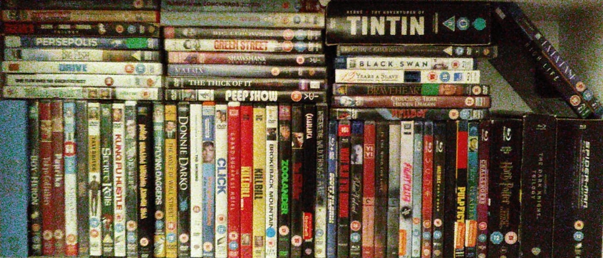

### The Future Of The Past Part 1 - Physical Media
#### November 3, 2026

<article>
Some things really did used to be better, and with modern advancements they should be even mega better.

> But they aren't. Why is that?

At some point capitalism's goal stopped being 'make the best thing' and we all suffer from that. It's led to poor quality products which to offend as few people as possible lose all personality, software deigned to atrophy our problem solving and social skills, and a media culture were consumers own nothing and rely completely on predators hoping to get everyone hooked before uping the price and pumping the ads.

This is not the future past me wanted, but luckily all these problems can be solved.
\
\
One DVD at a time.
</article>

#### All the Good Stuffs Still There and Its Cheaper Than Ever
<article>
For me it started two years ago, in a thrift store on Great Western Road, complete Harry Potter set on BluRay in hand.

> For £1 each you not only _actually_ own the films, but you also get all the bonus features!

This was huge for me. Imagine how many amazing behind the scenes, bloopers, featurettes and commentary tracks streaming services have deprived the world of; the Harry Potter set alone came with an eight part documentary on the making of the films. And streaming's bonus feature deprivation is on top of them making it as expensive as possible for you to subscribe to as many sites as possible to then not actually be buying anything. Behind the scenes show people what's possible, and streaming does not facilitie that.
\
\
After this I promptly bought a Playstation 3 for £70 at [Cex](https://uk.webuy.com/), which comes with a 5 year warranty as all their products do. Cex is simply the best store ever. As for the PS3 The nostalgia is certainly part of why I love it but it really is one of the most affordable good BluRay, DVD, and CD players out there. I filled this out with some cheap old speakers, a power amp, and an actual TV from the thrift store.
</article>

#### Hacking Things Should be the Norm
<article>
My disc collection kept growing, and I eventually came to a road block when I brought back some gems from the states. DVDs tend to be region locked, turns out. For most people this would never be a problem, but for the burdened few there's an easy fix:

> Hack your stuff to make it better!

You may know it as jailbreaking. I [set up HEN](https://m.youtube.com/watch?v=Ze3UMdMakvk&t=1558s&pp=ygUHcHMzIGhlbg%3D%3D), or 'Home Brew Enabler', on my PS3, which allows for a nifty service called MultiMan. MultiMan, among maannnyy other things, allows you to spoof your region and finally watch that entire Adventure Time boxset.
\
\
Around this time I also purchased a Nintendo DSi (Cex is great) and [set it up with custom firmware](https://dsi.cfw.guide/) to play all of my **cough** legally acquired GBA, DS, and DSi games.

</article>

#### Conclusions
<section>

What I've gained from this:
- I now own my media. I don't have to worry about which streaming service it's on and when they're going to take it off.
- I get to watch more of the stuff I love thanks to bonus features, and see things how the creators intended. Even DVD menus are charming bits of art.
- I'm not paying 10 subscriptions, I just pay for the actual things I want, whether that's in a thrift store, on ebay, or even new!
- Limited choice gives way to intentionality. I don't spend as long looking for something to watch as actually watching the thing. Everything I bought, I bought because I want to watch it, and I know exactly what I have.

That being said not everything is perfect, and this approach has it's limitations. In my eyes streaming does offer two genuine advantages:
- Watching ~your~ a collection from anyware. DVDs by being an actual thing exist in one actual place.
- Having very niche and international entries. When you do find these in the shop it's amazing, but even with ebay you can only go so far.

In the next part of this blog series I'm going to cover how to solve both of these problems by upcycling any old computer into your own self-hosted media server and cloud storage.
\
\
Thanks for listening to my ramblings <3

-JC3

</section>