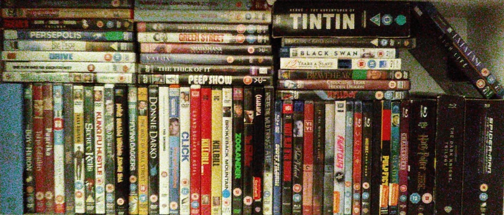
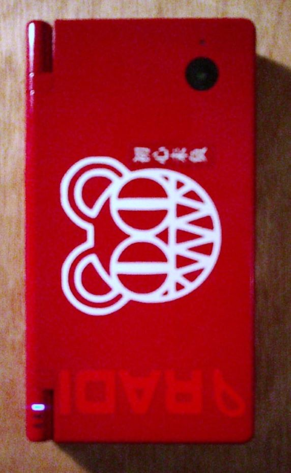

### Good Stuff's Still Out There And It's Cheaper Than Ever
#### November 4, 2026

<article>

A lot of stuff made in the past still holds up, and in many ways is better than current offerings.

Through the customizability that's near common place with old stuff, we can make things work perfectly for ourselves and show our personailities in the process.  That sentiment applies far beyond what's in this blog post, which I'm sure will become clear as I keep filling out this page.

</article>

#### DVDs, BluRays & CDs
<article>

When Netflix came out it was great, *buuut* it sneakily was actually not great.

Streaming services have a lot of disadvantages, most obvious of which is that, they're expensive and scattered, but they also don't promote intentionality with the media we consume, you don't *own* anything, and there's no bonus features. Some of the DVDs I've purchased come with more bonus content than actual content, and if you love a film or a show, that's pretty cool.

I started buying discs a couple years ago now and am quite proud of what my collection has grown to. I got myself a PS3, potentially still the best value BluRay player on the market, some cheap old speakers and amp, and a TV from the thrift store and I haven't looked back.

> By happenstance my TV is Sony and it lets me control the PS3 with the TV remote ( ͡~ ͜ʖ ͡° )

</article>

#### Hacking Things Should be the Norm

<article>

I eventually came to a road block when I brought back some gems from the states. DVDs tend to be region locked, turns out, which for most people would never be a problem, but for the burdened few there's an easy fix:

> Hack your stuff to make it better

You may know it as jailbreaking. I [set up HEN](https://m.youtube.com/watch?v=Ze3UMdMakvk&t=1558s&pp=ygUHcHMzIGhlbg%3D%3D), or 'Home Brew Enabler', on my PS3 to set that baby boy free and let us finally watch that entire Adventure Time boxset.

Around this time I also purchased a Nintendo DSi (both at Cex, Cex is great) and [set it up with custom firmware](https://dsi.cfw.guide/) to play all of my **cough** legally acquired GBA, DS, and DSi games. It is at least good as it was new, probably better.

</article>

#### Conclusions

<section>

So much old technology is still amazing, and with lower prices and increased hackability, potentially the best it's ever been.

What I've gained from this:
- Actually owning my media
- Bonus features, and lovely DVD menus
- Only paying for things I want, in a thrift store, online, or even new
- Limited choice gives way to intentionality; everything I bought, I bought because I want to watch it, and I know exactly what I have

That being said not everything is perfect, and this approach has it's limitations. In my eyes streaming does offer two genuine advantages:

- Watching ~your~ a collection from anyware; DVDs by being an actual thing exist in one actual place
- Having very niche and international entries; when you do find these in the shop it's amazing, but even Ebay and Cex only go so deep

In a future entry I'll show off how I solved both of these problems for myself by upcycling an old computer into my own self-hosted media server and cloud storage, but for now I'll leave it there.
\
\
Thanks for reading <3

-JC3

</section>