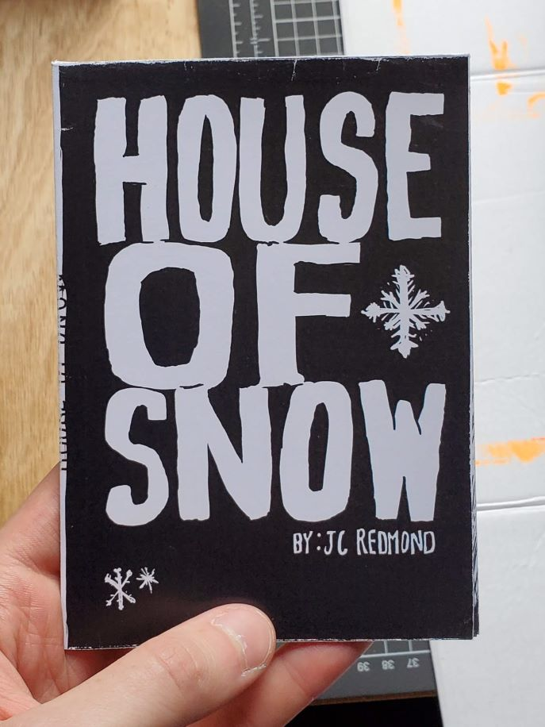
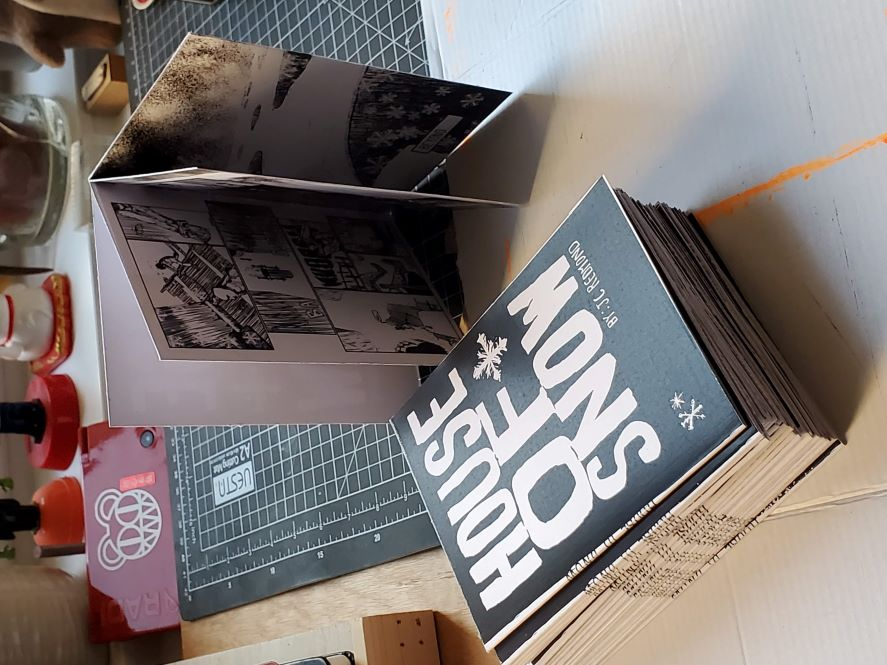
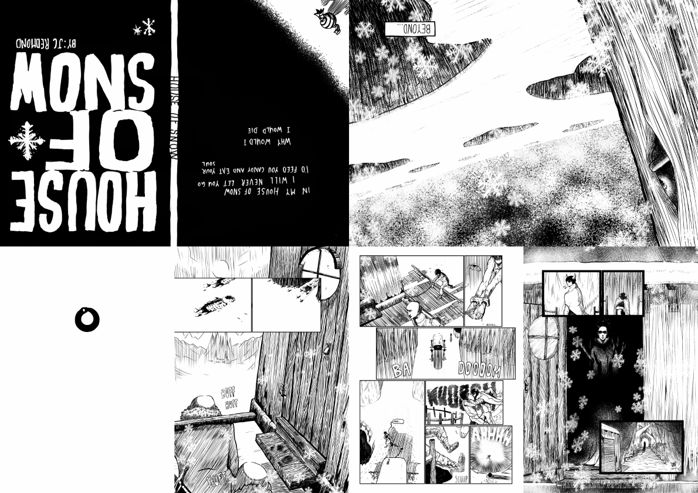

### My First Zine Is Based On A Breadstain Song
<h4 class="date">
    November 13, 2026
</h4>

<section>
    
    
</section>

<article>

It's Friday the 13th today and I'm finally getting around to showing off my first little comic. The idea for it comes from a song in the original Breadstain setlist, more specifically the music video idea we had for it, as is clear by the shared title.

I sketched and inked with a free app on my tablet and put it all together in Inkscape, which in the end took me about 10 hours per page.

> ಠ_ಠ 

</article>

<section>
    
</section>

<article>

I printed the zines on A3 paper and folded/glued them together in standard zine fashion.

I started the first page nearly a year ago (!) and the rest got pulled in and out of focus around other projects as these things often do for me. Although the initial scope was larger, I'm quite happy with the decision to limit it to 5 pages and with the end result.

I've also got a song to record for my solo album inspired by HoS, but that's not for today...

</article>
 
<section>

Hope you enjoy the zine! They're in the shop or feel free to <a href="https://portfolio.jc3.red/projects/art/zine/printable.png" target="_blank">print one for yourself</a> :)

-JC3

</section>